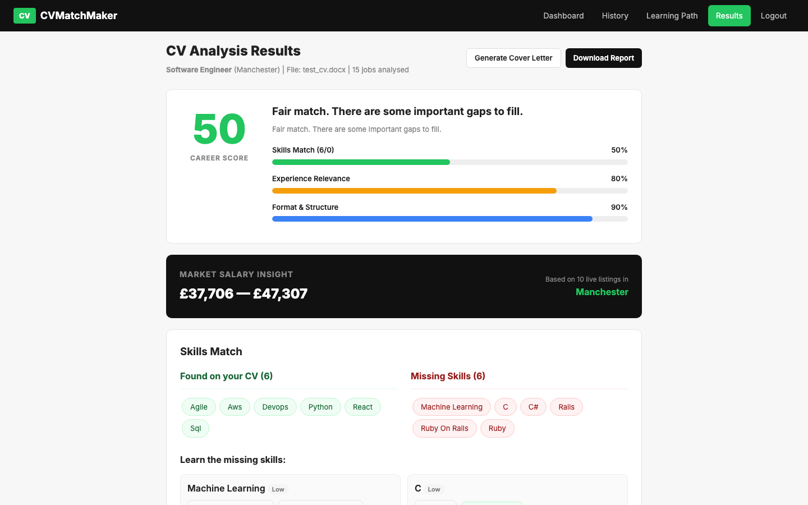
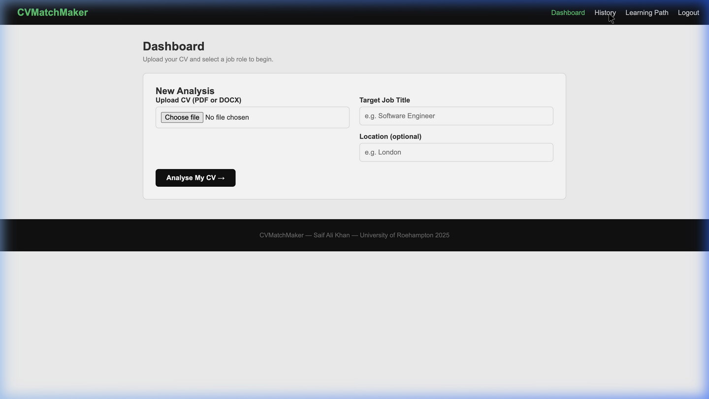
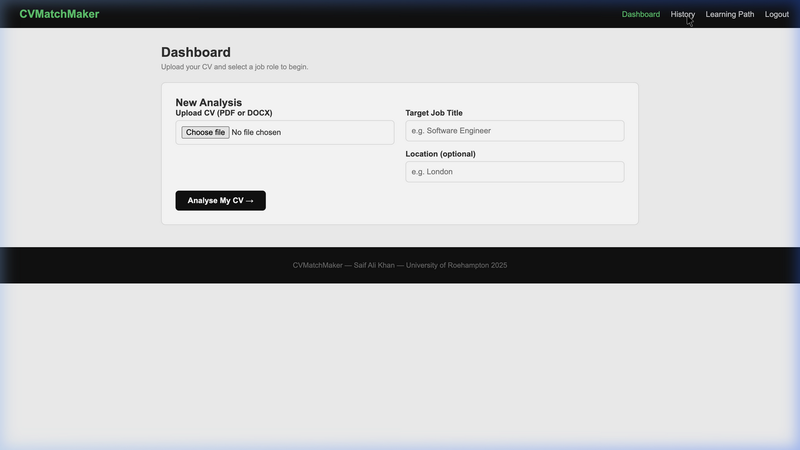
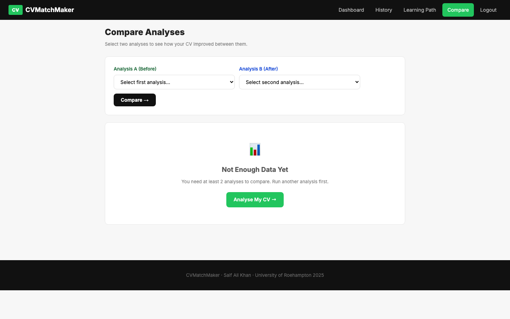

# CVMatchMaker

[](https://github.com/Saif1231231/FinalYear/actions/workflows/ci.yml)

**Live demo:** https://cvmatchmaker.onrender.com <!-- update once deployed -->

Upload your CV, type a job title, and CVMatchMaker compares your skills against live UK job listings. It tells you which in-demand skills you're missing, how often employers ask for them, and where to learn them.

Built solo as my BEng Software Engineering final-year project (First Class Honours, University of Roehampton).



## Features

- **CV vs market analysis.** Parses a PDF or DOCX CV, pulls real listings from the Reed.co.uk API, and scores how many of the skills employers ask for are on your CV.
- **Missing skills, ranked.** Gaps are ordered by how often they appear across listings, each with learning resources.
- **Sub-scores you can act on.** *Experience relevance* checks whether your matched skills are backed by real use in your Experience or Projects sections, not just listed. *Format & structure* is the share of CV quality checks passed.
- **Salary insight** from the salary ranges in the listings analysed.
- **Extras:** generated cover letter, interview questions for your gaps, LinkedIn tips, alternative job titles that fit your skills.
- **Progress tracking:** analysis history with a score trend chart, side-by-side comparison of two analyses, and a learning-path checklist.

| Dashboard | History | Compare |
|---|---|---|
|  |  |  |

## How it works

```
CV (PDF/DOCX) ──► cv_parser ──► sections (Skills, Experience, Projects…)
                                     │
                                     ▼
                          skill_extractor (spaCy)
                 phrase matching + lemma matching + synonym normalisation,
                 weighted by section (Skills 2.0, Experience 1.5, Projects 1.3)
                                     │
Job title + location ──► job_fetcher (Reed API) ──► skills per listing
                                     │
                                     ▼
                     analyser: matched ∩, missing −, frequency,
                     sub-scores, salary range, recommendations
                                     │
                                     ▼
                Flask + SQLAlchemy ──► results stored per user (JSON)
```

- **Score** = matched skills ÷ all distinct skills found across the listings.
- If no `REED_API_KEY` is set, the app falls back to built-in sample listings so it always runs.

## Tech stack

Python · Flask · Flask-Login · Flask-SQLAlchemy · spaCy · PostgreSQL (production) / SQLite (local) · PyMuPDF / PyPDF2 · python-docx · gunicorn · Docker · GitHub Actions · Render

## Security

- Passwords hashed with PBKDF2 (Werkzeug); minimum length enforced.
- Every per-analysis route checks ownership and returns 404 for other users' data (covered by tests).
- Uploads limited to 5MB, PDF/DOCX only, parsed in memory and never written to disk.
- Secret key and database URL come from environment variables; secure, HTTP-only session cookies in production.

## Run locally

```bash
git clone https://github.com/Saif1231231/FinalYear.git
cd FinalYear
python -m venv .venv && source .venv/bin/activate
pip install -r requirements.txt
cp .env.example .env
cd app && python app.py        # http://localhost:5000
```

Or with Docker:

```bash
docker build -t cvmatchmaker .
docker run -p 8000:8000 -e SECRET_KEY=dev cvmatchmaker   # http://localhost:8000
```

## Tests

```bash
pip install pytest
pytest -q
```

16 tests cover sign-up and login, upload validation, the full upload → analysis → results flow, cross-user access control, the learning-path API, and the skill extraction and scoring logic. They run on every push via GitHub Actions.

## Deployment

Deployed on Render (`render.yaml`) with a free PostgreSQL database from Neon. Set `DATABASE_URL`, and optionally `REED_API_KEY`, in the Render dashboard. `SECRET_KEY` is generated automatically.

## What I'd do next

- Use embeddings instead of a fixed skills list, so unknown skills are recognised.
- Cache Reed API results per job title to cut latency.
- Add database migrations with Alembic.
